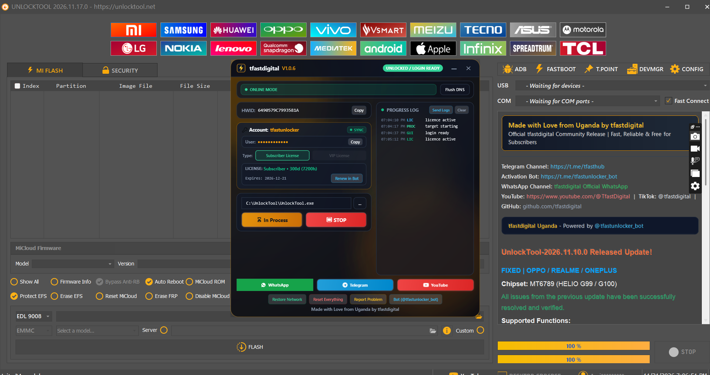
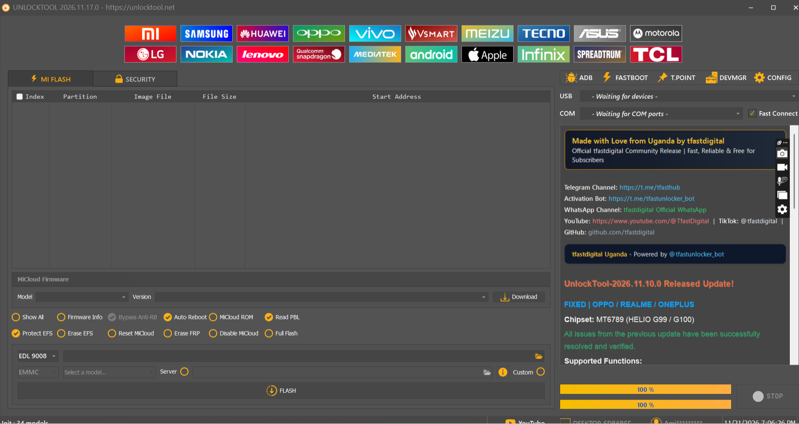

# UnlockTool Loader — Full Setup (`v1.0.8 / 2026.11.23.0`)

Official public download page and release notes for **tfastdigital UnlockTool Loader** (Made with Love from Uganda 🇺🇬).

- **Last Updated:** `Nov. 23, 2026` (`v1.0.8`)
- **Official Portal Page:** [https://tfastunlocker.com/unlocktool-loader](https://tfastunlocker.com/unlocktool-loader)
- **Download Full All-in-One Setup (UnlockTool 2026.11.17.0 + Loader v1.0.8, 310 MB):** [UnlockTool-loader ALLINONE V1.0.8 -2026.11.23.0-Setup.exe](https://github.com/tfastdigital/tfastdigital-unlocktool/releases/download/v1.0.8-2026.11.17.0/UnlockTool-loader.ALLINONE.V1.0.8.-2026.11.23.0-Setup.exe)
- **Download Loader Only (85 MB):** [tfastdigital Unlocktool loader v1.0.8.exe](https://github.com/tfastdigital/tfastdigital-unlocktool/releases/download/v1.0.8-2026.11.17.0/tfastdigital.Unlocktool.loader.v1.0.8.exe)
- **License & Activation Bot:** [@tfastunlocker_bot](https://t.me/tfastunlocker_bot)
- **Official Telegram Channel:** [@tfasthub](https://t.me/tfasthub)
- **YouTube:** [@TfastDigital](https://www.youtube.com/@TfastDigital)
- **WhatsApp Channel:** [Official Channel](https://www.whatsapp.com/channel/0029VaAYznPK5cDIXJa9nW1a)

---

## Quick Start

1. Join the official Telegram channel **[@tfasthub](https://t.me/tfasthub)**.
2. Open **[@tfastunlocker_bot](https://t.me/tfastunlocker_bot)** and generate your PC license key.
3. Download and run **`UnlockTool-loader ALLINONE V1.0.8 -2026.11.23.0-Setup.exe`** as Administrator (installs both **UnlockTool 2026.11.17.0** and **tfastdigital Unlocktool loader v1.0.8.exe**).
4. Launch **tfastdigital Unlocktool loader v1.0.8**, accept the Terms & Conditions, paste your license key to activate, and click **START**.

---

## Loader Version History (Changelog)

### `v1.0.8` — `2026-11-23` (Latest)
- Renamed All-in-One installer to **`UnlockTool-loader ALLINONE V1.0.8 -2026.11.23.0-Setup.exe`** and loader executable to **`tfastdigital Unlocktool loader v1.0.8.exe`**.
- Fixed false **VIP EXPIRED** status badge on active VIP licenses & short-duration VIP trials.
- Fixed **`HTTP/1.1 503 - State : Query Info`** fallback so UnlockTool launches reliably even during upstream server hiccups.
- Fixed default target path to **`C:\UnlockTool\UnlockTool.exe`** (while still allowing custom browse via `...`).
- Added atomic per-key VIP persistence, flexible VIP trial durations (minutes, hours, days), and **`🔍 My Status`** / VIP key lookup in `@tfastunlocker_bot` showing which PC is using your license.

### `v1.0.7` — `2026-11-23`
- Added **System Fix / AV** popup (1-click Windows Defender/AV exclusions, Firewall rules, and IPv6 disable) to fix socket permission (`10013`) errors.
- Added automatic pre-launch port clearing (`80, 443, 8080, 8090-8093, 8899, 9099`), `winnat` reset, DNS flush, and Windows Time sync.
- Launched the **Telegram Mini App**, **2-way Live Support Chat** with read/seen receipts, and **Ban Appeals** in `@tfastunlocker_bot`.
- Added machine-bound DPAPI + AES-256-GCM account data protection.

### `v1.0.6` — `2026-11-21` to `2026-11-22`
- Initial `UnlockTool 2026.11.17.0` All-in-One Setup release with `@tfastunlocker_bot` live membership verification, Upstash Redis persistence, dark-glass security dialogs, non-banning Windows Date & Time sync check, and Admin Reset PC Lock.

---

## Video Setup & Activation Guide

▶ **[Watch Step-by-Step Setup & Activation Guide on YouTube](https://youtu.be/8Vv6ZlgoBL0)**

---

## Screenshots

| tfastdigital Loader + UnlockTool | UnlockTool Opened |
| --- | --- |
|  |  |

---

## Release Notes — UnlockTool

- **Version:** `2026.11.17.0`
- **Hash:** `ca2660ca981cf6733ada6a9f8a452570`
- **Update on:** `Nov. 17, 2026, 5:37 a.m.`

### Change Log — `UnlockTool-Setup-2026.11.17.0` Released Update

#### MAINTENANCE UPDATE – FASTER STARTUP
- UnlockTool is now available as a setup executable (`.exe`) and must be installed before use.
- The new installer-based version reduces startup time by more than 50% compared to the previous portable version.

#### MAJOR UPDATE – SAMSUNG MTK V6 SUPPORT
- **Chipset:** `MT6789` | `MT6878`
- **Method:** Remove FRP via Download Mode (`CTRL 1` & `CTRL 0`). Added to the **Samsung → Odin Mode** tab in UnlockTool.
- **Supported Functions:** Remove FRP

**Supported Device List:**
- Samsung Galaxy A06 (`SM-A066M`)
- Samsung Galaxy A06 5G (`SM-A066E`)
- Samsung Galaxy A07 (`SM-A075F`)
- Samsung Galaxy A07 (`SM-A075M`)
- Samsung Galaxy A07 5G (`SM-A076M`)
- Samsung Galaxy A07 5G (`SM-A076E`)
- Samsung Galaxy A07 5G (`SM-A076B`)
- Samsung Galaxy A08 (`SM-A085F`)
- Samsung Galaxy A11+ (`SM-X230`)
- Samsung Galaxy A15 (`SM-A155F`)
- Samsung Galaxy A15 (`SM-A156U`)
- Samsung Galaxy A15 5G (`SM-A1560`)
- Samsung Galaxy A15 5G (`SM-A156E`)
- Samsung Galaxy A15 5G (`SM-A156L`)
- Samsung Galaxy A16 (`SM-A165F`)
- Samsung Galaxy A17 4G (`SM-A175F`)
- Samsung Galaxy F07 (`SM-E075F`)
- Samsung Galaxy M07 (`SM-M075F`)
- Samsung Galaxy Tab A9 (`SM-X130`)

#### MTK UPDATE – FIXES & IMPROVEMENTS (NOV 17, 2026)
- **MT6789:** Fixed issues affecting certain device models and improved compatibility and success rate across supported MT6789 devices.

#### YouTube Video Guides – Current & Previous Versions
- [SAMSUNG MTK V6 SUPPORT - Remove FRP via Download Mode (CTRL 1 & CTRL 0) | UnlockTool Guide](https://youtu.be/GG0PnBUrig4)
- [OPPO / realme / OnePlus – MTK New Security 2026 Supported | UnlockTool Guide](https://youtu.be/ps11HVaUl4c)
